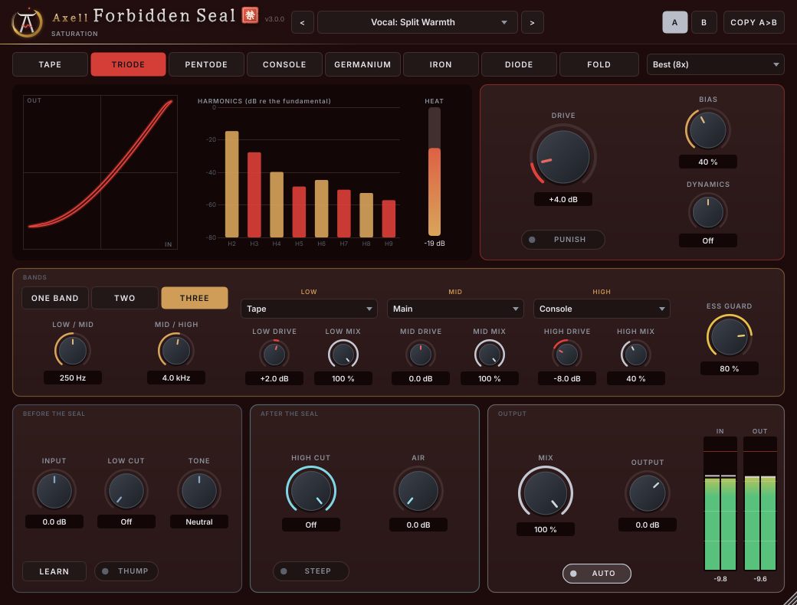

# Axell Forbidden Seal (VST3, Linux)

The saturation of the Axell suite: eight circuits modelled from physics, a live view of what they do to your sound,
anti-aliasing that stays clean when you drive them hard, and the suite's own voice intelligence - your esses kept out
of the grit.

- **Eight styles**: TAPE (magnetic hysteresis), TRIODE, PENTODE (push-pull), CONSOLE (transformer into class A),
  GERMANIUM (a starving vintage transistor), IRON (transformer core), DIODE, FOLD - each with a CHARACTER control
  (tape speed, tube bias, class A to B, core size...).
- **BANDS**: up to three phase-coherent bands, each with its own circuit, drive and mix.
- **ESS GUARD**: the suite's sibilance network finds the esses and keeps them out of the saturation, at their natural
  balance to the vowels - no fizz on the S sounds, however hard you drive the rest.
- **DYNAMICS**: the drive follows the level - more bite on the accents, or thicker quiet parts.
- **INPUT + LEARN**: plays your take for 6 seconds and sets the level so every style and preset behaves as designed,
  whatever level the take was recorded at.
- **AUTO** keeps the loudness while you turn DRIVE, so you compare colour, not volume.
- **QUALITY** from Eco (2x) to Extreme (16x) oversampling, and **Live (4x)** with about 4 samples of latency for
  recording through it.

> **Part of Axell's Dojo** - the Axell Signature suite for rap vocals, beats and masters on Linux:
> [Penta EQ](https://github.com/zmardanian/axell-penta-eq) · [Duo Compressor](https://github.com/zmardanian/axell-duo-compressor) ·
> [Gate](https://github.com/zmardanian/axell-gate) · [De-Reverb](https://github.com/zmardanian/axell-dereverb) ·
> [Velvet](https://github.com/zmardanian/axell-velvet) · [Master](https://github.com/zmardanian/axell-master) ·
> [Space](https://github.com/zmardanian/axell-space) · Forbidden Seal, installed and updated by the
> [Axell Signature Dojo](https://github.com/zmardanian/axell-signature-dojo).

More screens: [tape and its hysteresis loop](docs/screenshots/seal-tape.png), [triode](docs/screenshots/seal.png),
[push-pull pentode](docs/screenshots/seal-pentode.png), [the wavefolder](docs/screenshots/seal-fold.png).

## What it does

**The circuits** - every model is our own design from circuit physics (references in THIRD_PARTY_NOTICES.md):

| Style | Circuit | Sound | CHARACTER |
|---|---|---|---|
| TAPE | Jiles-Atherton hysteresis between record pre-emphasis and playback de-emphasis, head bump, gap loss | highs saturate first, the lows thicken, odd harmonics | tape speed 7.5 - 30 ips |
| TRIODE | a 12AX7-type stage on its load line, grid conduction and the bias shift it causes | even harmonics, warm and punchy | cathode bias, cold to hot |
| PENTODE | a push-pull power stage with supply sag | odd harmonics, aggressive, blooming | class A to cold class B (crossover grit) |
| CONSOLE | an input transformer into a class-A transistor stage | weight and density | transformer size |
| GERMANIUM | a low-headroom germanium stage whose bias starves on loud passages | gritty, sputtering | starve |
| IRON | transformer core saturation | low-end weight | core size |
| DIODE | a diode clipper, one diode against two in series | clean edges to grit | asymmetry |
| FOLD | a wavefolder | metallic, ring-like | offset |

**Before the seal** (what distorts): INPUT + LEARN, LOW CUT + THUMP (a resonant bump at the low cut), TONE (a tilt).
**After the seal**: HIGH CUT (6 dB/oct, or STEEP: 30 dB/oct), AIR. **Output**: MIX (parallel saturation), OUTPUT,
AUTO. **Drive**: DRIVE, PUNISH (+20 dB), CHARACTER, DYNAMICS. A live view draws the transfer curve of the current
style (tape draws its loop) and the harmonics it makes (even in gold, odd in red), and HEAT shows how much it adds.

## Measured quality

**Aliasing** - energy away from the harmonics, a brutal case (a 7.5 kHz tone 18 dB over full scale into the circuit):

| | Good 4x / Live 4x | Best 8x (default) | Extreme 16x |
|---|---|---|---|
| tube, transistor, diode and fold styles | -56 to -96 dB | -72 to -125 dB | -94 to -140 dB |
| TAPE (hysteresis has memory: no antiderivative anti-aliasing) | -38 dB | -62 dB | -113 dB |

On realistic material (3 kHz at -12 dBFS, +18 dB drive) every style is below -97 dB at Best. Against an open-source
tape model at its 8x setting, at more saturation (THD -25 dB vs its -36 dB): -129 vs -74 dB on the brutal case,
-210 vs -83 dB on the realistic one, with 6.5 % of a core vs its 10.6 %.

**AUTO** keeps the loudness within 0.6 dB from DRIVE 0 to +30 dB on a voice it was never calibrated on.
**ESS GUARD**, the real network, on an independent voice: 59.6 dB less distortion on the esses, their balance to the
vowels as in the input (+0.15 dB), the vowels unchanged. On the artist's own dry vocal, the grit preset without the
guard pushed the esses up 1.45 dB against their words; with the guard, 0.15 dB.
**BANDS**: linear, the crossovers re one band within 0.0005 dB and 0.001 deg (80 Hz - 5 kHz).
**Latency**: Best 82 samples at 44.1/48 kHz (36 at 96 kHz), Live 4 samples; reported to the host (the handshake waits
for the host before a new latency plays). MIX 0 and host bypass give the input delayed by it, bit for bit.
**CPU** (stereo, 48 kHz, Best 8x, 128-sample blocks): 2.9 - 6.5 % of one core per style; three bands + ESS GUARD 13 %.

**Verified for 3.0.1**: DSP 184, plugin 32, ASan + UBSan clean, independent audit 55/55, pluginval strictness 10 (also with the plugin built with AddressSanitizer: clean), Steinberg's VST3 validator 47/47.

## Install (Linux)

Download `AxellForbiddenSeal-3.0.1-linux-x86_64.tar.gz` from the
[latest release](https://github.com/zmardanian/axell-forbidden-seal/releases/latest) (optional: `sha256sum -c SHA256SUMS.txt`), then:

    tar xzf AxellForbiddenSeal-3.0.1-linux-x86_64.tar.gz
    cd AxellForbiddenSeal-3.0.1-linux-x86_64
    ./install.sh

Then in REAPER: Options > Preferences > Plug-ins > VST > Re-scan. On a vocal: press LEARN while the take plays, pick a
style or a "Vocal:" preset, turn DRIVE to taste; ESS GUARD on for rap vocals.

## Build (Bazzite / any Linux, inside a distrobox)

    bash scripts/setup-toolbox.sh
    bash scripts/build.sh
    bash scripts/test.sh               # DSP + plugin suites (--quick, --asan)
    bash scripts/pluginval.sh

The DSP lives in JUCE-free headers (`Source/Engine.h`, `Source/IirOversampler.h`) plus the shared Axell core in
`external/axell-core` or `../axell-core` (oversampler, sibilance network, loudness). `tools/SealCalibrate.cpp`
measures AUTO's table, `tools/SealRender.cpp` renders files and test tones, `research/measure.py` measures every style.

## Contact

Axell Yobag - axellpetre@protonmail.com. Issues on GitHub are welcome too.

Licence: GNU AGPLv3 (`LICENSE`); third-party components and the training-data notices of the sibilance network in
`THIRD_PARTY_NOTICES.md`. No code, data, captured responses or graphics of any commercial product are used; the
products that inspired the feature set were studied from their public manuals and described behaviour.
