

<picture>
  <source media="(prefers-color-scheme: dark)" srcset="docs/img/type/hero-dark.png">
  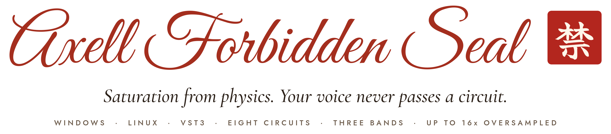
</picture>

  
  
  
  
  
  

  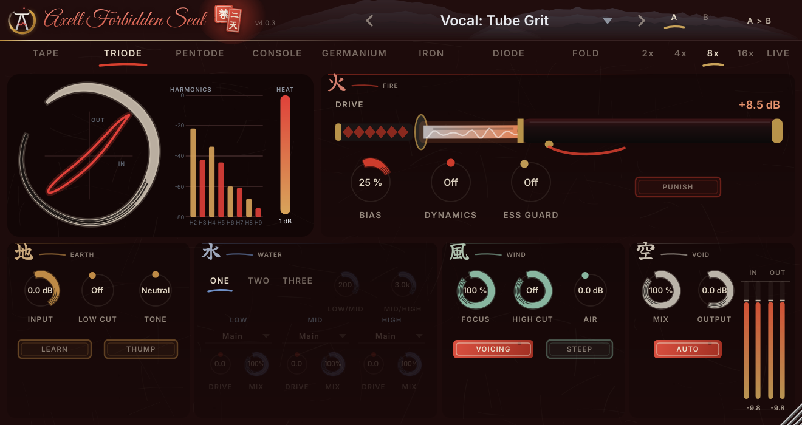

  <b>Saturation that never touches your voice - only what it adds.</b> 
  Eight circuits modelled from physics. In 4.0 the voice never passes a circuit: what each circuit adds is split into its squash and its new harmonics, and the harmonics are placed where they flatter a voice.

  <a href="https://github.com/zmardanian/axell-forbidden-seal/releases/latest"><picture>
  <source media="(prefers-color-scheme: dark)" srcset="docs/img/type/dl-windows-dark.png">
  
</picture></a>
  &nbsp;&nbsp;
  <a href="https://github.com/zmardanian/axell-forbidden-seal/releases/latest"><picture>
  <source media="(prefers-color-scheme: dark)" srcset="docs/img/type/dl-linux-dark.png">
  
</picture></a>

Free and open source (AGPL-3.0)  ·  Windows 10 / 11 and Linux  ·  any VST3 host - FL Studio, Ableton Live, Cubase, Studio One, Bitwig, REAPER

 

<picture>
  <source media="(prefers-color-scheme: dark)" srcset="docs/img/type/h-why-dark.png">
  
</picture>

- **Decoupled saturation** - your highs stay silky, your mids never turn to a box - the voice itself is never processed.
- **Measured against a respected tape emulation** - at equal squash: less box at 61 of 64 points, the predicted listener score matched at every point.
- **Eight circuits from physics** - tape hysteresis, triode, push-pull pentode, console, germanium, iron, diode, fold.
- **Esses out of the grit** - ESS GUARD keeps them clean: guarded esses at -137 dB of residue.
- **A face like no other** - DRIVE is a katana drawn from its scabbard; the blade heats with the drive.

 

<picture>
  <source media="(prefers-color-scheme: dark)" srcset="docs/img/type/h-does-dark.png">
  
</picture>

The saturation of the Axell suite: eight circuits modelled from physics, and - new in 4.0 - **decoupled saturation**:
the voice never passes a circuit; what each circuit adds is split into its squash and its new harmonics, and the
harmonics are placed where they flatter a voice - out of the vowels' range where a saturator turns mids into a box, out of
the fizz band, into weight and bite. Your highs stay silky; your esses stay out of the grit.

- **Eight styles**: TAPE (magnetic hysteresis), TRIODE, PENTODE (push-pull), CONSOLE (transformer into class A),
  GERMANIUM (a starving vintage transistor), IRON (transformer core), DIODE, FOLD - each with a CHARACTER control
  (tape speed, tube bias, class A to B, core size...).
- **BANDS**: up to three phase-coherent bands, each with its own circuit, drive and mix.
- **ESS GUARD**: the suite's sibilance network finds the esses and keeps them out of the saturation, at their natural
  balance to the vowels - no fizz on the S sounds, however hard you drive the rest.
- **DYNAMICS**: the drive follows the level - more bite on the accents, or thicker quiet parts.
- **FOCUS** (4.0): where the colour lands - tuned per circuit and per drive on a real voice against a respected tape
  machine emulation; 0 % = the classic circuit, all of its colour wherever it falls.
- **VOICING** (4.0): the seal's tone - a touch of weight, the honk range eased, a breath of air; off = the voice exactly as it
  came in.
- **INPUT + LEARN**: plays your take for 6 seconds and sets the level so every style and preset behaves as designed,
  whatever level the take was recorded at.
- **AUTO** keeps the loudness while you turn DRIVE, so you compare colour, not volume.
- **QUALITY** from Eco (2x) to Extreme (16x) oversampling, and **Live (4x)** with about 4 samples of latency for
  recording through it.

The face (4.0): DRIVE is a katana drawn out of its scabbard - the blade heats with the drive, its temper line ripples with
what the circuit makes; every other control is a brush ensō that closes with its value; switches are hanko seals;
Miyamoto Musashi's painting seal 二天 (Niten) stamped over 禁, glowing with HEAT; the sections named after his five rings
(地 earth, 水 water, 火 fire, 風 wind, 空 void). 660 x 350 at 100 %, resizable to 200 %. Every control: drag (Shift: fine),
mouse wheel, double-click to the default, right-click to type a value.

More screens: [tape and its hysteresis loop](docs/screenshots/seal-tape.png), [triode](docs/screenshots/seal.png),
[push-pull pentode](docs/screenshots/seal-pentode.png), [the wavefolder](docs/screenshots/seal-fold.png).

**The circuits** - every model is our own design from circuit physics (references in THIRD_PARTY_NOTICES.md):

| Style | Circuit | Sound | CHARACTER |
|---|---|---|---|
| TAPE | Jiles-Atherton hysteresis between record pre-emphasis and playback de-emphasis, head bump, gap loss | highs saturate first, the lows thicken, odd harmonics | tape speed 7.5 - 30 ips |
| TRIODE | a 12AX7-type stage on its load line, grid conduction and the bias shift it causes | even harmonics, warm and punchy | cathode bias, cold to hot |
| PENTODE | a push-pull power stage with supply sag | odd harmonics, aggressive, blooming | class A to cold class B (crossover grit) |
| CONSOLE | an input transformer into a class-A transistor stage | weight and density | transformer size |
| GERMANIUM | a low-headroom germanium stage whose bias starves on loud passages | gritty, sputtering | starve |
| IRON | transformer core saturation | low-end weight | core size |
| DIODE | a diode clipper, one diode against two in series | clean edges to grit | asymmetry |
| FOLD | a wavefolder | metallic, ring-like | offset |

**Before the seal** (what distorts): INPUT + LEARN, LOW CUT + THUMP (a resonant bump at the low cut), TONE (a tilt).
**After the seal**: HIGH CUT (6 dB/oct, or STEEP: 30 dB/oct), AIR. **Output**: MIX (parallel saturation), OUTPUT,
AUTO. **Drive**: DRIVE, PUNISH (+20 dB), CHARACTER, DYNAMICS. A live view draws the transfer curve of the current
style (tape draws its loop) and the harmonics it makes (even in gold, odd in red), and HEAT shows how much it adds.

<table>
<tr><td align="center" width="50%">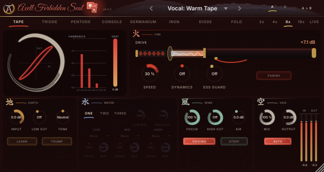 TAPE and its hysteresis loop</td><td align="center" width="50%">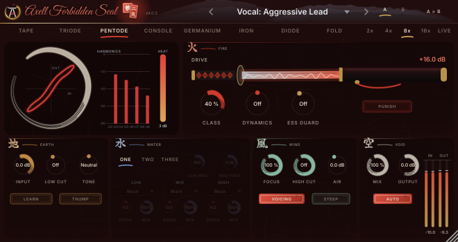 Push-pull PENTODE</td></tr>
<tr><td align="center" width="50%">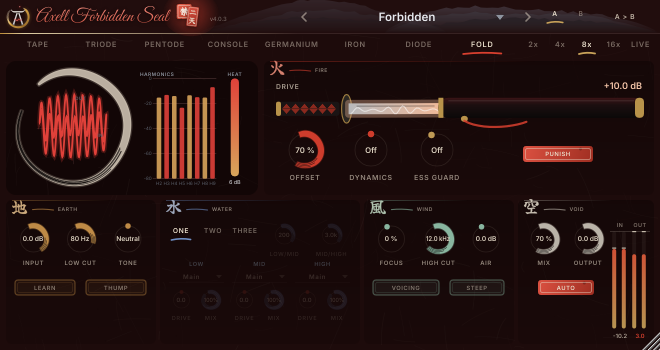 The wavefolder</td><td align="center" width="50%">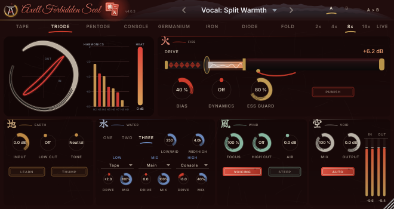 Three BANDS</td></tr>
</table>

 

<picture>
  <source media="(prefers-color-scheme: dark)" srcset="docs/img/type/h-measured-dark.png">
  
</picture>

**On a real voice (4.0)** - the artist's dry vocal at the level LEARN sets, every circuit and drive, against a respected
commercial tape-machine emulation at both its speeds, compared at **equal squash** (the vowels' dynamics):
box below the reference's at 61 of 64 points, air within its window at 61, fizz below at 56, honk below at 56, no mud at 63; the predicted listener score (UTMOS) matches the reference's at every tested point (within 0.03). The harmonics' level is set exactly there: at equal squash 4.0 adds less low and bite grit than the reference (weight above it at 2 of 64 points, bite at 28) - more grit is a DRIVE or FOCUS turn away.
Against 3.0.1 on the same voice at equal squash: less box, more air, less fizz, less honk at every circuit.

**Aliasing** - energy away from the harmonics, a brutal case (a 7.5 kHz tone 18 dB over full scale into the circuit):

| | Best 8x (default) | Extreme 16x |
|---|---|---|
| tube, transistor, diode and fold styles | -107 to -151 dB | -127 to -151 dB |
| TAPE (hysteresis has memory: no antiderivative anti-aliasing) | -75 dB at 44.1 kHz, -92 at 48, -130 at 96 | -124 to -140 dB |

On realistic material (3 kHz at -12 dBFS, +18 dB drive) every style is below -115 dB at Best.

**The voice untouched**: a voice 60 dB down comes back within -59 dB of itself through every circuit (VOICING off).
**A steady sound stays steady** (no flutter, pumping, crackle): a periodic vowel through every circuit, with AUTO,
DYNAMICS, ESS GUARD and LIVE, varies by 0.003 dB in frames of whole periods; ESS GUARD switching every 50 ms adds nothing.
**AUTO** keeps the loudness within 0.06 dB from DRIVE 0 to +30 dB (a voice it was never calibrated on), measuring the
vowels alone - a guarded ess never steers it.
**ESS GUARD** (the real network, an independent voice): guarded esses come out at -137 dB of residue re the input
(unguarded: -20 dB), their balance to the vowels as in the input (-0.08 dB), the vowels at the input's loudness (+0.08 dB).
**BANDS**: linear, the crossovers re one band within 0.0005 dB and 0.001 deg (80 Hz - 5 kHz).
**Latency**: Best 82 samples at 44.1/48 kHz (36 at 96 kHz), Live 4 samples, + 12 ms while ESS GUARD is on; reported to the
host (the handshake waits for the host before a new latency plays). MIX 0 and host bypass give the input delayed by it.
**CPU** (stereo, 48 kHz, Best 8x, 128-sample blocks): 3.2 - 6.3 % of one core per style; three bands + ESS GUARD 13 %.

**Verified for 4.0.3**: DSP 220, plugin 33, ASan + UBSan clean, independent audit 63/63, core 143, pluginval strictness 10,
Steinberg's VST3 validator 47/47; 268 renders byte-identical to 4.0.1 (4.0.2 is a speed-up: DIODE -5 %, TRIODE -3 %).
4.0.1 fixed a crash at extreme drive with the sound unchanged (264 renders bit-identical to 4.0.0).

 

<picture>
  <source media="(prefers-color-scheme: dark)" srcset="docs/img/type/h-install-dark.png">
  
</picture>

### Windows

> [!TIP]
> **The whole suite in one go:** the [Axell Signature Suite installer](https://github.com/zmardanian/axell-signature-dojo/releases/latest) puts every Axell plugin and the Dojo on Windows 10 / 11 in one step, each one optional - and the Dojo keeps them up to date. Every VST3 host loads them: FL Studio, Ableton Live, Cubase, Studio One, Bitwig, REAPER.

Windows 10 / 11, 64-bit. Download `AxellForbiddenSeal-<version>-windows-x64.tar.gz` from the
[latest release](https://github.com/zmardanian/axell-forbidden-seal/releases/latest) (optional: check it against `SHA256SUMS.txt`),
extract it (Windows 11 opens .tar.gz directly; on Windows 10 use 7-Zip or `tar -xzf` in a terminal) and copy the folder
`Axell Forbidden Seal.vst3` into `C:\Program Files\Common Files\VST3`. Then rescan plugins in your DAW.
Or install the whole suite in one go with the Axell Signature Suite installer from the
[Axell Signature Dojo releases](https://github.com/zmardanian/axell-signature-dojo/releases/latest) - the Dojo then keeps it up to date.

Every Windows build is made by GitHub Actions from this repository, passes the same test suites and pluginval
(strictness 10) as the Linux build, and is checked to sound the same as it (largest difference far below -90 dBFS,
most often bit-identical). The plugin is not code-signed yet; DAWs load it directly.

### Linux

Runs on x86_64 Linux with glibc 2.35 or newer: Ubuntu 22.04+, Debian 12+, Linux Mint 21+, Fedora 36+, Arch, Bazzite.

Download `AxellForbiddenSeal-4.0.3-linux-x86_64.tar.gz` from the
[latest release](https://github.com/zmardanian/axell-forbidden-seal/releases/latest) (optional: `sha256sum -c SHA256SUMS.txt`), then:

    tar xzf AxellForbiddenSeal-4.0.3-linux-x86_64.tar.gz
    cd AxellForbiddenSeal-4.0.3-linux-x86_64
    ./install.sh

Then in REAPER: Options > Preferences > Plug-ins > VST > Re-scan. On a vocal: press LEARN while the take plays, pick a
style or a "Vocal:" preset, turn DRIVE to taste; ESS GUARD on for rap vocals.

 

<picture>
  <source media="(prefers-color-scheme: dark)" srcset="docs/img/type/h-suite-dark.png">
  
</picture>

<table>
<tr><td align="center"><a href="https://github.com/zmardanian/axell-penta-eq"><picture>
  <source media="(prefers-color-scheme: dark)" srcset="docs/img/suite/penta-eq-dark.png">
  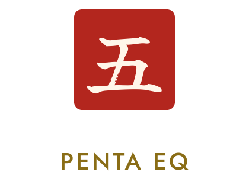
</picture></a> analog-matched EQ</td><td align="center"><a href="https://github.com/zmardanian/axell-duo-compressor"><picture>
  <source media="(prefers-color-scheme: dark)" srcset="docs/img/suite/duo-compressor-dark.png">
  
</picture></a> FET + opto + limiter</td><td align="center"><a href="https://github.com/zmardanian/axell-gate"><picture>
  <source media="(prefers-color-scheme: dark)" srcset="docs/img/suite/gate-dark.png">
  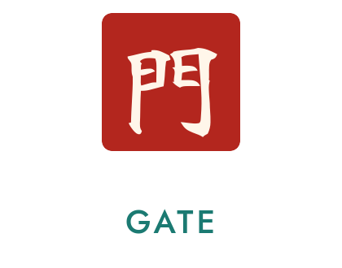
</picture></a> voice-aware gate</td><td align="center"><a href="https://github.com/zmardanian/axell-dereverb"><picture>
  <source media="(prefers-color-scheme: dark)" srcset="docs/img/suite/dereverb-dark.png">
  
</picture></a> small-room de-reverb</td><td align="center"><a href="https://github.com/zmardanian/axell-velvet"><picture>
  <source media="(prefers-color-scheme: dark)" srcset="docs/img/suite/velvet-dark.png">
  
</picture></a> neural de-esser + warmth</td></tr>
<tr><td align="center"><a href="https://github.com/zmardanian/axell-master"><picture>
  <source media="(prefers-color-scheme: dark)" srcset="docs/img/suite/master-dark.png">
  
</picture></a> mastering limiter</td><td align="center"><a href="https://github.com/zmardanian/axell-space"><picture>
  <source media="(prefers-color-scheme: dark)" srcset="docs/img/suite/space-dark.png">
  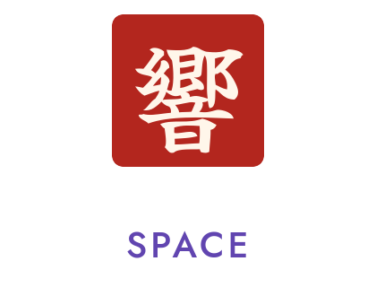
</picture></a> vocal reverb + delay</td><td align="center"><a href="https://github.com/zmardanian/axell-forbidden-seal"><picture>
  <source media="(prefers-color-scheme: dark)" srcset="docs/img/suite/forbidden-seal-dark.png">
  
</picture></a> saturation</td><td align="center"><a href="https://github.com/zmardanian/axell-76"><picture>
  <source media="(prefers-color-scheme: dark)" srcset="docs/img/suite/76-dark.png">
  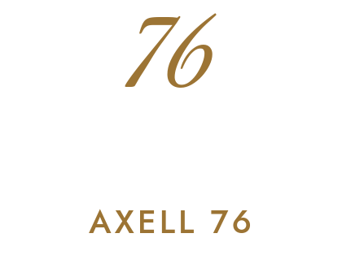
</picture></a> 1176 FET compressor</td><td align="center"><a href="https://github.com/zmardanian/axell-signature-dojo"><picture>
  <source media="(prefers-color-scheme: dark)" srcset="docs/img/suite/signature-dojo-dark.png">
  
</picture></a> the suite's home</td></tr>
</table>

Nine plugins and their home, built as one family: they share a core library, so a breakthrough in one becomes a feature of the next - the sibilance network of Velvet guards the esses in Duo, Master, Space and Forbidden Seal; Gate's voice detector holds Duo's and Master's gain through your pauses. The [Axell Signature Dojo](https://github.com/zmardanian/axell-signature-dojo) installs, updates and tunes the whole suite to your voice - on Windows from a single installer.

 

<picture>
  <source media="(prefers-color-scheme: dark)" srcset="docs/img/type/h-build-dark.png">
  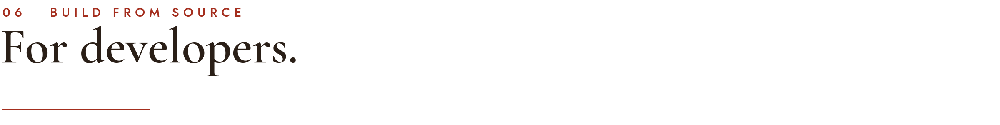
</picture>

    bash scripts/setup-toolbox.sh
    bash scripts/build.sh
    bash scripts/test.sh               # DSP + plugin suites (--quick, --asan)
    bash scripts/pluginval.sh

The DSP lives in JUCE-free headers (`Source/Engine.h`, `Source/IirOversampler.h`) plus the shared Axell core in
`external/axell-core` or `../axell-core` (oversampler, sibilance network, loudness). `tools/SealCalibrate.cpp`
measures AUTO's table, `tools/SealRender.cpp` renders files and test tones, `research/measure.py` measures every style.

 

<picture>
  <source media="(prefers-color-scheme: dark)" srcset="docs/img/type/h-credits-dark.png">
  
</picture>

**Free forever, kept alive by you.** Axell Forbidden Seal costs nothing and never will - no subscriptions, no licence keys. If it has earned a place in your mixes, you can [support the Dojo on Ko-fi](https://ko-fi.com/axellyobag) - one-time or monthly, from €3.

Axell Yobag - contact@axellsdojo.com. Issues on GitHub are welcome too.

Licence: GNU AGPLv3 (`LICENSE`); third-party components and the training-data notices of the sibilance network in
`THIRD_PARTY_NOTICES.md`. No code, data, captured responses or graphics of any commercial product are used; the
products that inspired the feature set were studied from their public manuals and described behaviour.

 

VST is a registered trademark of Steinberg Media Technologies GmbH. 1176, 1176LN, LA-2A, UADx and Universal Audio are trademarks of their respective owners. The Axell plugins are independent works, not affiliated with or endorsed by them; the names only describe what was measured and compared.
