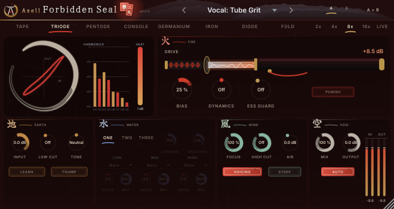

# Axell Forbidden Seal (VST3, Linux)

The saturation of the Axell suite: eight circuits modelled from physics, and - new in 4.0 - **decoupled saturation**:
the voice never passes a circuit; what each circuit adds is split into its squash and its new harmonics, and the
harmonics are placed where they flatter a voice - out of the vowels' range where a saturator turns mids into a box, out of
the fizz band, into weight and bite. Your highs stay silky; your esses stay out of the grit.

- **Eight styles**: TAPE (magnetic hysteresis), TRIODE, PENTODE (push-pull), CONSOLE (transformer into class A),
  GERMANIUM (a starving vintage transistor), IRON (transformer core), DIODE, FOLD - each with a CHARACTER control
  (tape speed, tube bias, class A to B, core size...).
- **BANDS**: up to three phase-coherent bands, each with its own circuit, drive and mix.
- **ESS GUARD**: the suite's sibilance network finds the esses and keeps them out of the saturation, at their natural
  balance to the vowels - no fizz on the S sounds, however hard you drive the rest.
- **DYNAMICS**: the drive follows the level - more bite on the accents, or thicker quiet parts.
- **FOCUS** (4.0): where the colour lands - tuned per circuit and per drive on a real voice against a respected tape
  machine emulation; 0 % = the classic circuit, all of its colour wherever it falls.
- **VOICING** (4.0): the seal's tone - a touch of weight, the honk range eased, a breath of air; off = the voice exactly as it
  came in.
- **INPUT + LEARN**: plays your take for 6 seconds and sets the level so every style and preset behaves as designed,
  whatever level the take was recorded at.
- **AUTO** keeps the loudness while you turn DRIVE, so you compare colour, not volume.
- **QUALITY** from Eco (2x) to Extreme (16x) oversampling, and **Live (4x)** with about 4 samples of latency for
  recording through it.

> **Part of Axell's Dojo** - the Axell Signature suite for rap vocals, beats and masters on Linux:
> [Penta EQ](https://github.com/zmardanian/axell-penta-eq) · [Duo Compressor](https://github.com/zmardanian/axell-duo-compressor) ·
> [Gate](https://github.com/zmardanian/axell-gate) · [De-Reverb](https://github.com/zmardanian/axell-dereverb) ·
> [Velvet](https://github.com/zmardanian/axell-velvet) · [Master](https://github.com/zmardanian/axell-master) ·
> [Space](https://github.com/zmardanian/axell-space) · Forbidden Seal, installed and updated by the
> [Axell Signature Dojo](https://github.com/zmardanian/axell-signature-dojo).

The face (4.0): DRIVE is a katana drawn out of its scabbard - the blade heats with the drive, its temper line ripples with
what the circuit makes; every other control is a brush ensō that closes with its value; switches are hanko seals;
Miyamoto Musashi's painting seal 二天 (Niten) stamped over 禁, glowing with HEAT; the sections named after his five rings
(地 earth, 水 water, 火 fire, 風 wind, 空 void). 660 x 350 at 100 %, resizable to 200 %. Every control: drag (Shift: fine),
mouse wheel, double-click to the default, right-click to type a value.

More screens: [tape and its hysteresis loop](docs/screenshots/seal-tape.png), [triode](docs/screenshots/seal.png),
[push-pull pentode](docs/screenshots/seal-pentode.png), [the wavefolder](docs/screenshots/seal-fold.png).

## What it does

**The circuits** - every model is our own design from circuit physics (references in THIRD_PARTY_NOTICES.md):

| Style | Circuit | Sound | CHARACTER |
|---|---|---|---|
| TAPE | Jiles-Atherton hysteresis between record pre-emphasis and playback de-emphasis, head bump, gap loss | highs saturate first, the lows thicken, odd harmonics | tape speed 7.5 - 30 ips |
| TRIODE | a 12AX7-type stage on its load line, grid conduction and the bias shift it causes | even harmonics, warm and punchy | cathode bias, cold to hot |
| PENTODE | a push-pull power stage with supply sag | odd harmonics, aggressive, blooming | class A to cold class B (crossover grit) |
| CONSOLE | an input transformer into a class-A transistor stage | weight and density | transformer size |
| GERMANIUM | a low-headroom germanium stage whose bias starves on loud passages | gritty, sputtering | starve |
| IRON | transformer core saturation | low-end weight | core size |
| DIODE | a diode clipper, one diode against two in series | clean edges to grit | asymmetry |
| FOLD | a wavefolder | metallic, ring-like | offset |

**Before the seal** (what distorts): INPUT + LEARN, LOW CUT + THUMP (a resonant bump at the low cut), TONE (a tilt).
**After the seal**: HIGH CUT (6 dB/oct, or STEEP: 30 dB/oct), AIR. **Output**: MIX (parallel saturation), OUTPUT,
AUTO. **Drive**: DRIVE, PUNISH (+20 dB), CHARACTER, DYNAMICS. A live view draws the transfer curve of the current
style (tape draws its loop) and the harmonics it makes (even in gold, odd in red), and HEAT shows how much it adds.

## Measured quality

**On a real voice (4.0)** - the artist's dry vocal at the level LEARN sets, every circuit and drive, against a respected
commercial tape-machine emulation at both its speeds, compared at **equal squash** (the vowels' dynamics):
box below the reference's at 61 of 64 points, air within its window at 61, fizz below at 56, honk below at 56, no mud at 63; the predicted listener score (UTMOS) matches the reference's at every tested point (within 0.03). The harmonics' level is set exactly there: at equal squash 4.0 adds less low and bite grit than the reference (weight above it at 2 of 64 points, bite at 28) - more grit is a DRIVE or FOCUS turn away.
Against 3.0.1 on the same voice at equal squash: less box, more air, less fizz, less honk at every circuit.

**Aliasing** - energy away from the harmonics, a brutal case (a 7.5 kHz tone 18 dB over full scale into the circuit):

| | Best 8x (default) | Extreme 16x |
|---|---|---|
| tube, transistor, diode and fold styles | -107 to -151 dB | -127 to -151 dB |
| TAPE (hysteresis has memory: no antiderivative anti-aliasing) | -75 dB at 44.1 kHz, -92 at 48, -130 at 96 | -124 to -140 dB |

On realistic material (3 kHz at -12 dBFS, +18 dB drive) every style is below -115 dB at Best.

**The voice untouched**: a voice 60 dB down comes back within -59 dB of itself through every circuit (VOICING off).
**A steady sound stays steady** (no flutter, pumping, crackle): a periodic vowel through every circuit, with AUTO,
DYNAMICS, ESS GUARD and LIVE, varies by 0.003 dB in frames of whole periods; ESS GUARD switching every 50 ms adds nothing.
**AUTO** keeps the loudness within 0.06 dB from DRIVE 0 to +30 dB (a voice it was never calibrated on), measuring the
vowels alone - a guarded ess never steers it.
**ESS GUARD** (the real network, an independent voice): guarded esses come out at -137 dB of residue re the input
(unguarded: -20 dB), their balance to the vowels as in the input (-0.08 dB), the vowels at the input's loudness (+0.08 dB).
**BANDS**: linear, the crossovers re one band within 0.0005 dB and 0.001 deg (80 Hz - 5 kHz).
**Latency**: Best 82 samples at 44.1/48 kHz (36 at 96 kHz), Live 4 samples, + 12 ms while ESS GUARD is on; reported to the
host (the handshake waits for the host before a new latency plays). MIX 0 and host bypass give the input delayed by it.
**CPU** (stereo, 48 kHz, Best 8x, 128-sample blocks): 3.2 - 6.3 % of one core per style; three bands + ESS GUARD 13 %.

**Verified for 4.0.0**: DSP 220, plugin 32, ASan + UBSan clean, independent audit 63/63, core 143, pluginval strictness 10,
Steinberg's VST3 validator 47/47.

## Install (Linux)

Download `AxellForbiddenSeal-4.0.0-linux-x86_64.tar.gz` from the
[latest release](https://github.com/zmardanian/axell-forbidden-seal/releases/latest) (optional: `sha256sum -c SHA256SUMS.txt`), then:

    tar xzf AxellForbiddenSeal-4.0.0-linux-x86_64.tar.gz
    cd AxellForbiddenSeal-4.0.0-linux-x86_64
    ./install.sh

Then in REAPER: Options > Preferences > Plug-ins > VST > Re-scan. On a vocal: press LEARN while the take plays, pick a
style or a "Vocal:" preset, turn DRIVE to taste; ESS GUARD on for rap vocals.

## Build (Bazzite / any Linux, inside a distrobox)

    bash scripts/setup-toolbox.sh
    bash scripts/build.sh
    bash scripts/test.sh               # DSP + plugin suites (--quick, --asan)
    bash scripts/pluginval.sh

The DSP lives in JUCE-free headers (`Source/Engine.h`, `Source/IirOversampler.h`) plus the shared Axell core in
`external/axell-core` or `../axell-core` (oversampler, sibilance network, loudness). `tools/SealCalibrate.cpp`
measures AUTO's table, `tools/SealRender.cpp` renders files and test tones, `research/measure.py` measures every style.

## Contact

Axell Yobag - axellpetre@protonmail.com. Issues on GitHub are welcome too.

Licence: GNU AGPLv3 (`LICENSE`); third-party components and the training-data notices of the sibilance network in
`THIRD_PARTY_NOTICES.md`. No code, data, captured responses or graphics of any commercial product are used; the
products that inspired the feature set were studied from their public manuals and described behaviour.
